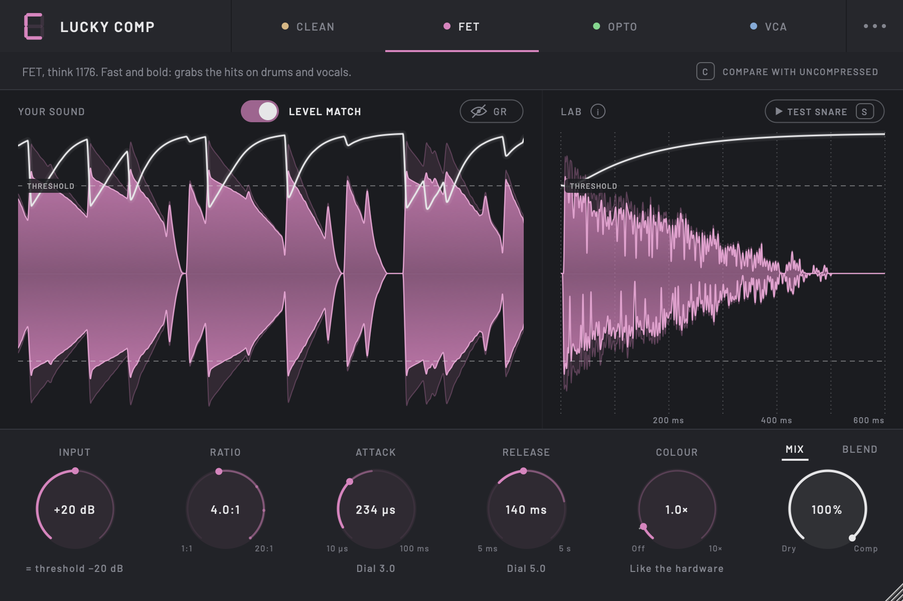

# Lucky Comp

Compression by ear. Lucky Comp is a free compressor for macOS (VST®3 and AU) that sounds great in a real mix and teaches you how compression works, and how the classic compressors differ, while you use it: four modes in the style of the classics on one set of dials, level matching so you hear the compression rather than the loudness, and a Lab that shows what your settings do to a single snare hit.

**[Website and download](https://tomdmaguire.github.io/lucky-comp/)** · a sibling of [Lucky Seven](https://github.com/tomdmaguire/lucky-seven) and [Lucky Reference](https://github.com/tomdmaguire/lucky-reference) · product spec in [`docs/spec.md`](docs/spec.md)



## Install

Download [**Lucky-Comp.pkg**](https://github.com/tomdmaguire/lucky-comp/releases/latest/download/Lucky-Comp.pkg) and open it. It installs the VST3 and the Audio Unit (Apple Silicon and Intel) into `/Library/Audio/Plug-Ins`.

Lucky Comp isn't signed or notarised by Apple (that needs a paid developer account), so macOS won't open the installer the first time. Click **Done**, then go to **System Settings → Privacy & Security**, scroll down and click **Open Anyway**.

A zip for installing by hand is also on the [releases page](https://github.com/tomdmaguire/lucky-comp/releases/latest); its `INSTALL.txt` explains the steps.

**Updating or removing.** The installer replaces the old version. If you ever copied Lucky Comp into `~/Library/Audio/Plug-Ins` by hand, delete those copies so your DAW doesn't load the old one. To remove Lucky Comp, delete `Lucky Comp.vst3` and `Lucky Comp.component` from `/Library/Audio/Plug-Ins/VST3` and `/Library/Audio/Plug-Ins/Components`.

## Features

- **Four modes on one set of dials**: Clean, plus FET, Opto and VCA in the style of the classics (think 1176, LA-2A and SSL bus compressor). Each follows its classic's published behaviour: attack and release ranges, ratios, how it lets go and the controls it gives you. Attack (10 µs to 100 ms), Release (5 ms to 5 s) and Ratio keep one scale in every mode, so you can see where each classic sits. Each mode remembers its own settings, Colour included; Mix and Blend are shared.
- **Level match** (on by default): the compressed sound is turned to the input's loudness (K-weighted), predicted from the last 3 seconds of your audio, so a change is matched within a few tens of milliseconds and comparing with uncompressed is fair. It never pushes a peak above −1 dBFS: if it can't match without doing so (hot drums, heavy settings), it turns the uncompressed side down instead, so the comparison stays fair and nothing clips. With Mix or Blend, the compressed side is matched on its own first, so the whole Mix knob is useful. The match is saved with your session.
- **Ears first**: the live view draws your audio before and after, the threshold, and the gain reduction as a line; the number stays hidden until you click **GR**, which asks first (you can turn the question off).
- **Tips**: one short line under the modes says what each one is and what it's good for.
- **The Lab**: a real snare (with a little room) run through your settings and drawn cycle by cycle. **S** plays it, compressed exactly as drawn, on its own path so it never touches your track.
- **Colour**: FET, Opto and VCA add the tone of their classic, voiced from published measurements of real units and from our own hardware measurements (see [`docs/colour-sources.md`](docs/colour-sources.md)). The dial goes from Off straight to 1× ("Like the hardware") and on up to 10×, since below 1× it's too faint to hear; turning it shows the harmonics it adds in the Lab.
- **Mix or Blend**: Mix crossfades from dry to compressed; Blend keeps the dry signal at 0 dB and adds the compressed one underneath (New York style).
- **Compare with uncompressed** with **C** (or the hint by the tips, or the ••• menu): your sound without compression, at the same loudness. The whole interface turns grey so you can't mistake it.
- **Window size** from 75% to 200%, and a menu to hide the mode info or the Lab.
- **Light**: about 0.1 to 0.6% of one core per instance at 48 kHz on an Apple Silicon Mac, the slowest block under 13% of its deadline at a 32-sample buffer, and no latency.

## Building

Requirements: macOS 13 or newer, Xcode (with the command line tools selected), CMake 3.25 or newer and Ninja, and [Lucky Labs](https://github.com/tomdmaguire/lucky-labs), the suite's shared code, checked out beside this folder (or pass `-DLUCKY_LABS_DIR=<path>`).

```sh
cmake -B build -G Ninja -DCMAKE_BUILD_TYPE=Release
cmake --build build
ctest --test-dir build
```

JUCE is fetched automatically by CMake. The plug-ins are copied into `~/Library/Audio/Plug-Ins` only if you configure with `-DLUCKY_COMP_INSTALL_AFTER_BUILD=ON`. Pushing a tag such as `v1.0.0` builds, tests and publishes the installer (`Lucky-Comp.pkg`) and a zip through GitHub Actions.

### Tools

```sh
build/LuckyCompBench [seconds]          # CPU per instance, level-match prediction and Lab timings
build/LuckyCompSnapshot <scene> out.png # renders the editor (clean, fet, opto, vca, ask, fet-colour, ...)
build/LuckyCompMeasure_artefacts/Release/LuckyCompMeasure ...  # measures a VST3, or hardware through an audio interface
```

Measurements of our own Behringer 676 and of Lucky Comp are in [`measurements/`](measurements/).

## Licence

Copyright (C) 2026 Tom Maguire. Lucky Comp is free software under the [GNU Affero General Public License v3.0](LICENSE), with no warranty. It is built with [JUCE](https://juce.com), used here under the AGPLv3; the licences of the third-party code it includes are in Lucky Labs' [`THIRD-PARTY-NOTICES.txt`](https://github.com/tomdmaguire/lucky-labs/blob/main/Resources/THIRD-PARTY-NOTICES.txt), which ships with every release. The interface is set in Barlow (SIL Open Font License, in [Lucky Labs](https://github.com/tomdmaguire/lucky-labs/blob/main/Resources/Fonts/OFL.txt)). The test snare is "kensnare1" by spacemanfan on freesound (CC0); see [`Resources/README.md`](Resources/README.md).

1176 and LA-2A are trademarks of Universal Audio, Inc.; SSL is a trademark of Solid State Logic; Behringer is a trademark of Music Tribe. Lucky Comp is an independent project, not affiliated with or endorsed by them; the names only describe the style each mode follows. VST is a registered trademark of Steinberg Media Technologies GmbH. Audio Units is a trademark of Apple Inc. Other product names are trademarks of their owners.
